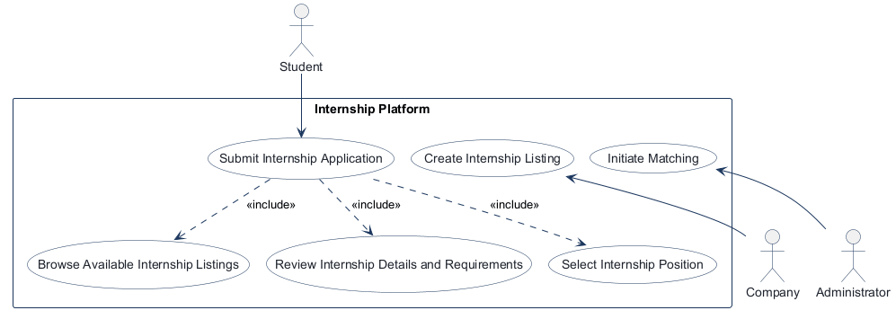
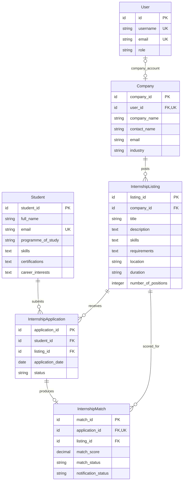
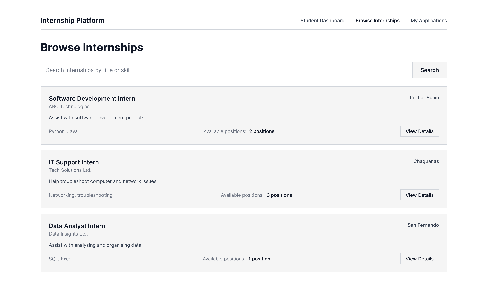
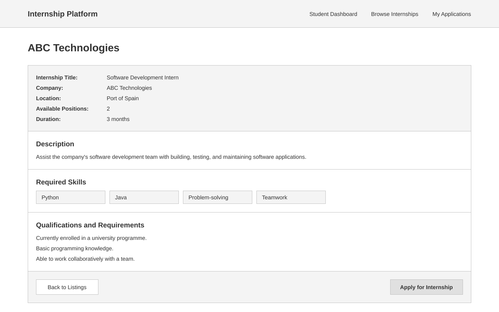
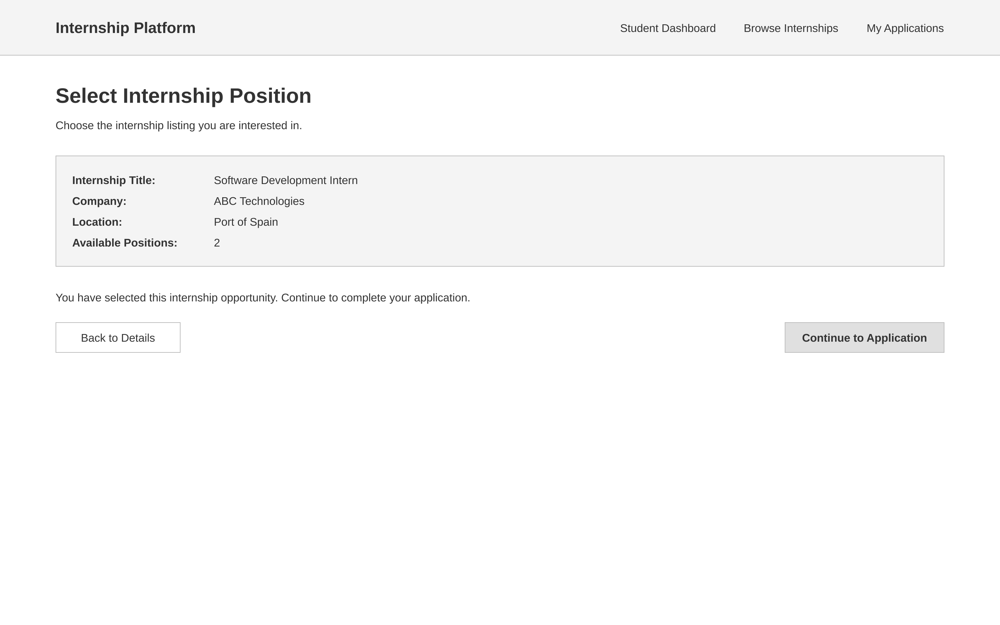
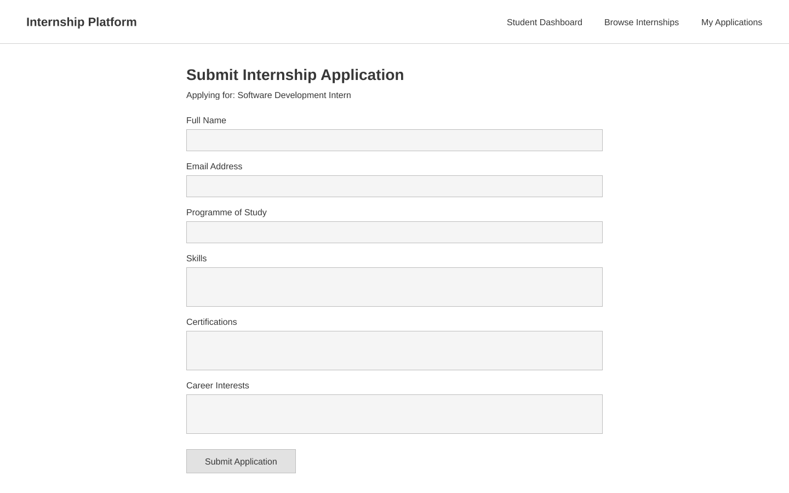
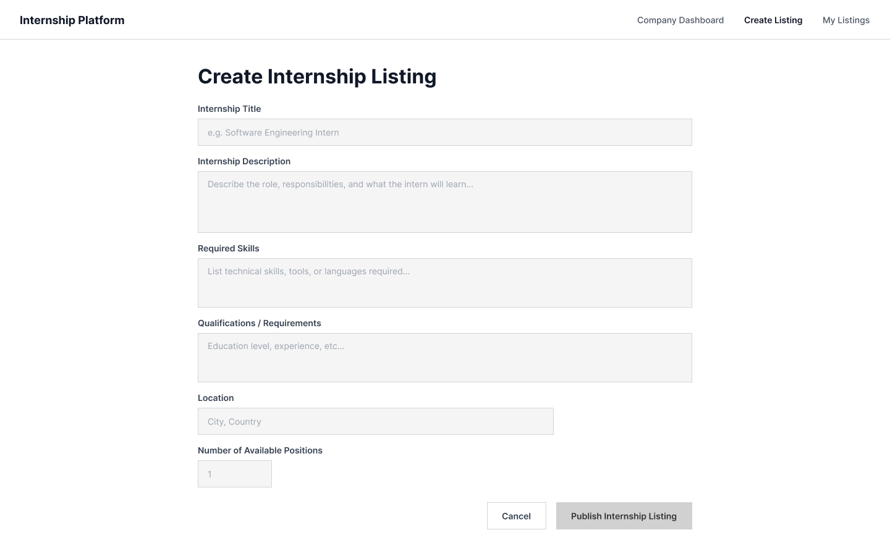
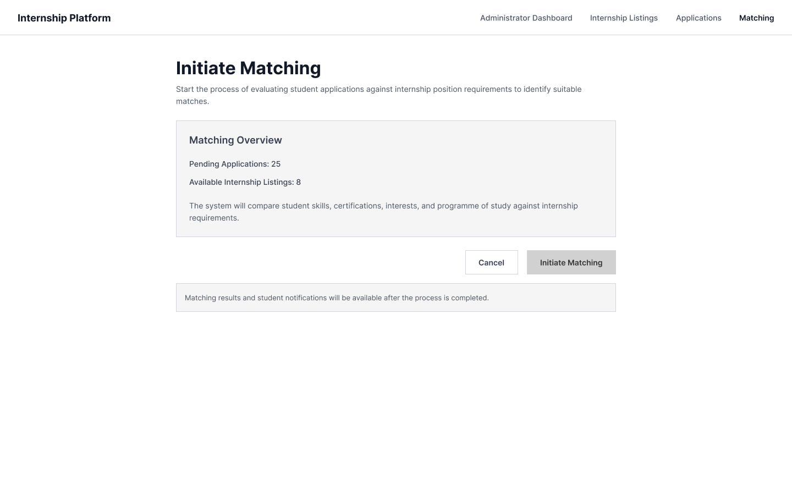

# COMP 3613 Assignment 1

Draft this file with the Guide. **Update it after every phase milestone** before you pause. The use-case diagram is a UML PNG at `docs/diagrams/use-case.png`, linked from this file as `diagrams/use-case.png` (path relative to `docs/report.md`). The model diagram is Mermaid. **Embed wireframe images** as `wireframes/<file>` (files live in `docs/wireframes/`).

Do not put your student ID in this file if you will commit it. The PDF cover adds your name and ID at export time.

## Assigned project

Internship Platform

## Three workflows

### 1. Submit Internship Application (Student)

### 2. Create Internship Listing (Company)

### 3. Match Applications to Internship Positions (Administrator)

## Use case diagram

Notes: Browsing available listings, reviewing position details and requirements, and selecting a position are included in submitting an application. “Initiate Matching” is the Administrator-started use case for the “Match Applications to Internship Positions” workflow; the matching workflow itself is unchanged. The named workflows are not shared across actors; no «extend» relationship was identified.

## Model diagram

Phase 3 first draft, revised in Phase 5 for the student application and company listing workflows.

Relationship and business-rule notes: each listing belongs to one company; a company can post multiple listings. A company account can be linked to at most one Company profile; the nullable `Company.user_id` preserves legacy Company rows that have no account. A student can submit applications to multiple listings, and each listing can receive applications from multiple students; `InternshipApplication` links the two, with at most one application per student-listing pair. Student email uniquely identifies the reusable profile. An application can have zero or one match record, and each match belongs to one application. `InternshipMatch.listing_id` is retained as requested and must equal that application's `listing_id`. Student skills, certifications, and interests, and listing skills, are represented as text.

## Wireframes

### Browse Internships

### View Internship Details and Requirements

### Select Internship Opportunity

### Submit Internship Application

### Create Internship Listing

### Initiate Matching

<!-- student-build:wireframe-coverage
use_case: Submit Internship Application
image: docs/wireframes/Submit Internship Application.png
covered: yes
-->

<!-- student-build:wireframe-coverage
use_case: Browse Internships
image: docs/wireframes/Browse Internships.png
covered: yes
-->

<!-- student-build:wireframe-coverage
use_case: View Internship Details and Requirements
image: docs/wireframes/View Internship details and requirements.png
covered: yes
-->

<!-- student-build:wireframe-coverage
use_case: Select Internship Application
image: docs/wireframes/Select Internship Application.png
covered: yes
-->

<!-- student-build:wireframe-coverage
use_case: Create Internship Listing
image: docs/wireframes/Create Internship Listing.png
covered: yes
-->

<!-- student-build:wireframe-coverage
use_case: Match Applications to Internship Positions / Initiate Matching
image: docs/wireframes/Initiate Matching.png
covered: yes
-->

Wireframe-driven model revisions:
- `InternshipListing.skills` — used by the browse search and shown on listing cards and details.
- `InternshipListing.duration` — shown on listing details; optional because the create-listing wireframe has no duration input.
- `Student.programme_of_study` and `Student.career_interests` — names aligned to the application form and stored on the reusable Student profile.
- `Student.email` is unique so one signed-in account resolves to one reusable Student profile.
- Company name is displayed through the listing's Company relationship rather than stored a second time on the listing.

Design note: the application flow is clear from browse -> select -> apply, but a final confirmation state after submission is not shown. The workflow is assumed to end on a return to the student dashboard or list view after a successful application submit.

`python manage.py report` also embeds any PNG/JPG still missing from `docs/wireframes/`.

## Theming

- Brand: Internship Platform; clean, professional, warm tone with a sans-serif system font.
- Palette: forest green `#244735` for the public header, navigation, headings, and primary actions; blush `#F5DDE5` for the header wordmark and restrained highlights; beige `#F2E8D8` for page backgrounds; white `#FFFFFF` for auth panels and main content; dark text for readability.
- Applied to the public landing, login, registration, and shared authenticated shell. Removed the starter landing copy and exposed demo credentials; `/config` and the existing authentication flows are preserved.
- Student, company, and administrator workflow screens use the shared theme.

## Implementation notes

One named workflow at a time. Include verify notes and polish / model revisions (Phase 5). Do not treat the first build as final.

For Submit Internship Application, the application record will be created only after the completed form is submitted. Applicant details will be saved on and reused from the Student profile.
The application email is prefilled from the signed-in account and must match it. The workflow includes internship search by title or skill, listing details, selection confirmation, and the application form; a successful submission returns to the student dashboard. `InternshipListing.skills` supports the browse filter, and optional `duration` supports the listing details wireframe. `company_name` is shown through the listing's Company relationship rather than duplicated on the listing. `python manage.py init` seeds the wireframe's three sample listings for the browse flow.

Submit Internship Application was verified by the student against the browse-to-submit workflow. The first `init --no-drop` run created the tables but failed during seeding because forward relationship annotations were interpreted as generic relationship targets. The collection forward references were corrected in `app/models/internship.py`; no tables were dropped or recreated.

For Create Internship Listing, companies self-register with account credentials and company profile details. Company-role routes protect the dashboard, create form, and My Listings page; My Listings queries are scoped to the authenticated account's Company profile. The form includes title, description, required skills, qualifications/requirements, location, and available positions. Positions must be at least one, validated in the browser, request binding, and service schema. Newly created listings use the existing `InternshipListing` model and catalogue query, so they are visible in student Browse Internships.

The Company–User relationship adds nullable, unique `Company.user_id` referencing `User.id`, preserving existing Company rows without assigning them an account. The approved additive SQLite migration was applied to the local `database.db`: it added the nullable FK column and unique index without dropping tables or assigning accounts to legacy rows. Before/after row counts remained unchanged (`company`: 3, `user`: 2, `internship_listing`: 3); all three existing Company rows remain unlinked. `PRAGMA foreign_key_check` returned no errors and `PRAGMA quick_check` returned `ok`. A verified backup was created outside the repository. Other environments still require the equivalent additive migration before deployment or use.

Create Internship Listing was verified by the student: company registration, listing creation, My Listings ownership, catalogue visibility, wireframe fields, and rejection of zero positions all passed. Detailed verification notes are pending.

For Match Applications to Internship Positions, the administrator's Initiate Matching action delegates to the matching service. The service evaluates only Submitted applications, scores normalized unique-keyword overlap, ranks deterministically per listing, respects available positions, and persists matched and not-matched outcomes idempotently. The student dashboard loads outcomes using the authenticated account email and displays listing title, status, score, and notification state; non-student roles are denied access to that dashboard. Static and isolated checks passed.

The student manually verified that Administrator login works; clicking Initiate Matching shows a success message and returns to the dashboard; the student dashboard displays a matching result with its status, score, and notification state; and rerunning matching leaves that result unchanged without creating a duplicate. These results cover the scenario tested; other matching cases and edge cases have not been confirmed manually.

<!-- student-build:code-check
workflow: Match Applications to Internship Positions
form: snippet
layer: model
architecture_ok: yes
implement_confidence: 0.90
passed: yes
note: Student-authored InternshipMatch model has a unique application constraint and paired relationships.
-->

<!-- student-build:code-check
workflow: Match Applications to Internship Positions
form: snippet
layer: router
architecture_ok: yes
implement_confidence: 0.90
passed: yes
note: Student-authored admin route delegates matching to the service; student dashboard uses the authenticated account email.
-->

<!-- student-build:code-check
workflow: Match Applications to Internship Positions
form: snippet
layer: service
architecture_ok: yes
implement_confidence: 0.90
passed: yes
note: Repository and service separate persistence from matching; isolated ranking, capacity, idempotency, and notification-state checks passed.
-->

<!-- student-build:code-check
workflow: Create Internship Listing
form: snippet
layer: model
architecture_ok: yes
implement_confidence: 0.90
passed: yes
note: Added the nullable unique Company.user_id foreign key and reciprocal SQLModel relationships.
-->

<!-- student-build:code-check
workflow: Create Internship Listing
form: snippet
layer: router
architecture_ok: yes
implement_confidence: 0.90
passed: yes
note: Bound all six listing fields and authenticated user, then delegated to service and redirected to My Listings.
-->

<!-- student-build:code-check
workflow: Submit Internship Application
form: choice
layer: service
architecture_ok: yes
implement_confidence: 0.85
passed: yes
note: Chose to persist an application only on completed form submission.
-->

<!-- student-build:code-check
workflow: Submit Internship Application
form: choice
layer: model
architecture_ok: yes
implement_confidence: 0.85
passed: yes
note: Chose to store and reuse application details on the Student profile.
-->

<!-- student-build:code-check
workflow: Submit Internship Application
form: choice
layer: service
architecture_ok: yes
implement_confidence: 0.90
passed: yes
note: Chose to prefill and require the application email to match the signed-in account.
-->

<!-- student-build:code-check
workflow: Submit Internship Application
form: snippet
layer: model
architecture_ok: yes
implement_confidence: 0.85
passed: yes
note: Added all Student profile fields from the ERD and form; email is unique for profile reuse.
-->

<!-- student-build:code-check
workflow: Submit Internship Application
form: open
layer: service
architecture_ok: yes
implement_confidence: 0.90
passed: yes
note: Correctly identified that service and repository bodies are scaffold placeholders to be implemented after the thin route snippet.
-->

<!-- student-build:code-check
workflow: Submit Internship Application
form: snippet
layer: router
architecture_ok: yes
implement_confidence: 0.90
passed: yes
note: Route binds form data, calls the application service, and redirects without persistence queries.
-->

## Deployed app

Phase 6. Public Render URL (not localhost). Markers open this to mark the three workflows.

https://

## Logins

Every account a marker needs, including extra users you added. The following credential is for local development only:

- bob / bobpass — regular user

Production Administrator: provisioned from the Render-only `ADMIN_INITIAL_PASSWORD` secret when the `admin` account is first created. Enter the actual marker login here after deployment; do not use the local default.

## YouTube URL

## Session transcripts

Filled when the Guide builds the report: the agent writes each Guide chat to `docs/transcripts/<slug>.md` (Copilot Agent, Cursor, or OpenCode). `python manage.py report` packages them. Do not paste chats here during the build.

## Competency (student-judge)

Filled when the report is built. Guide runs student-judge, writes `docs/judge.md`, and export appends the scorecard here.

## Skill integrity

Filled by `python manage.py report`. Do not edit the course skills.
